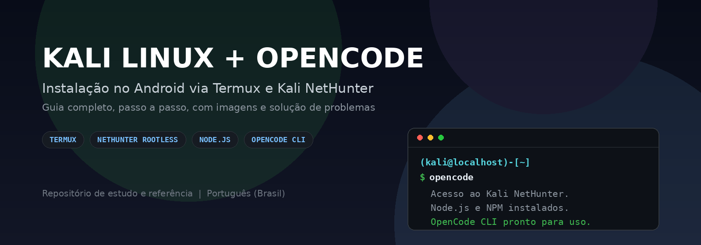
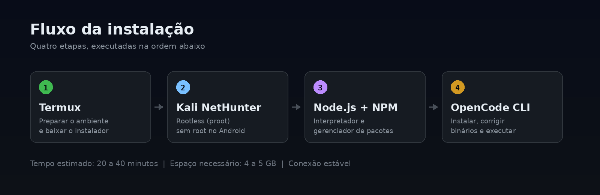
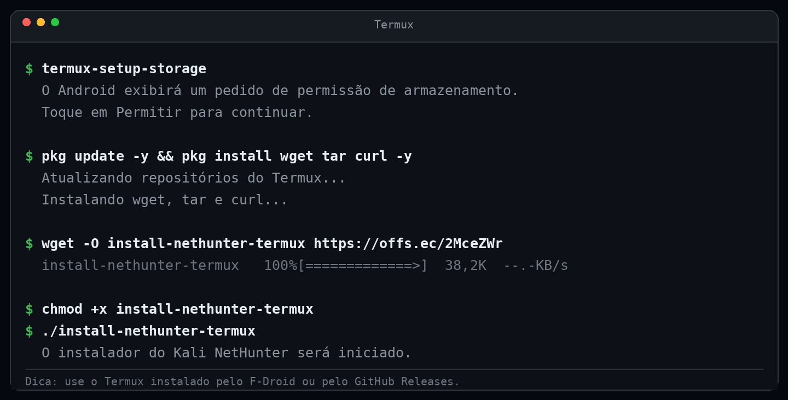
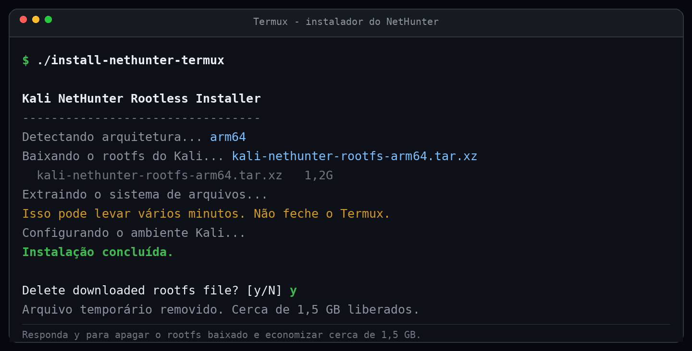
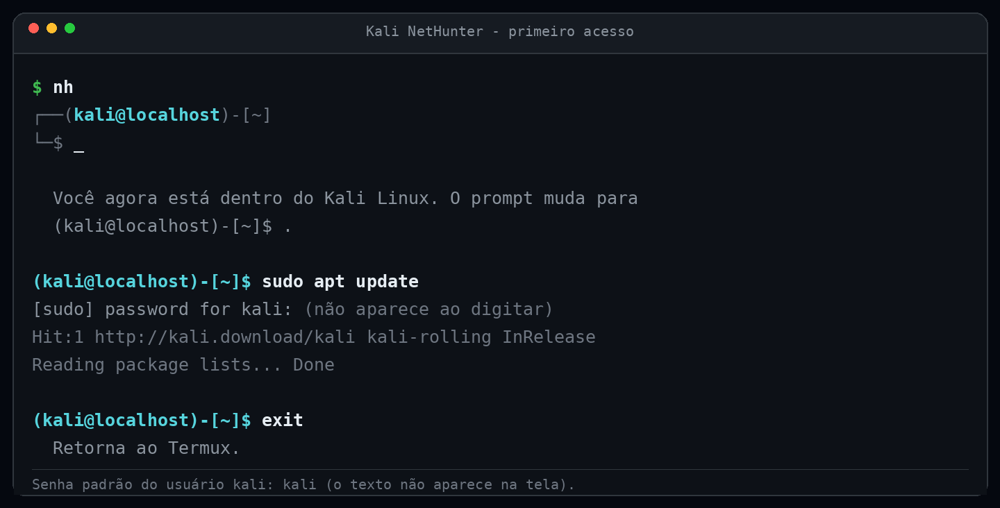
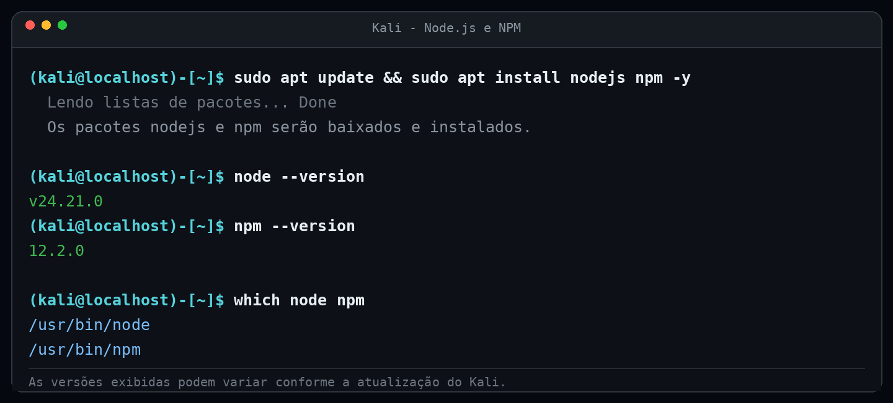
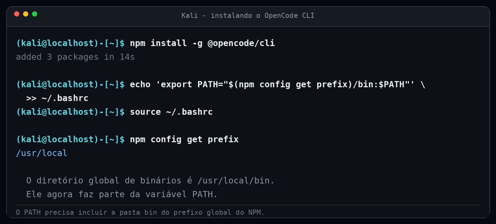
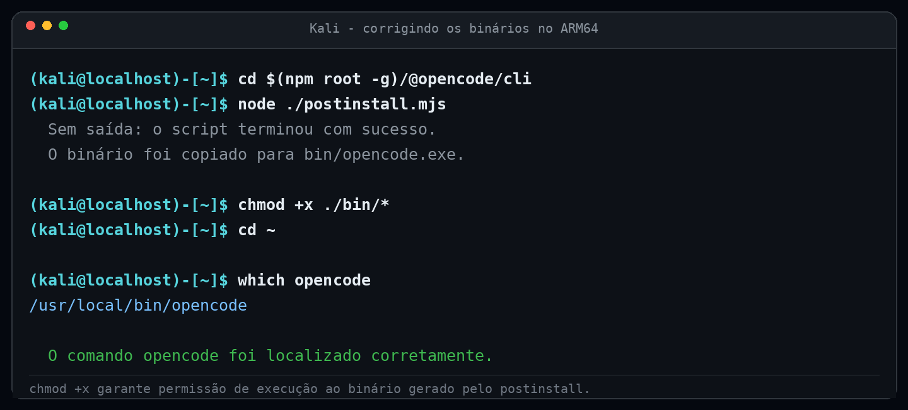
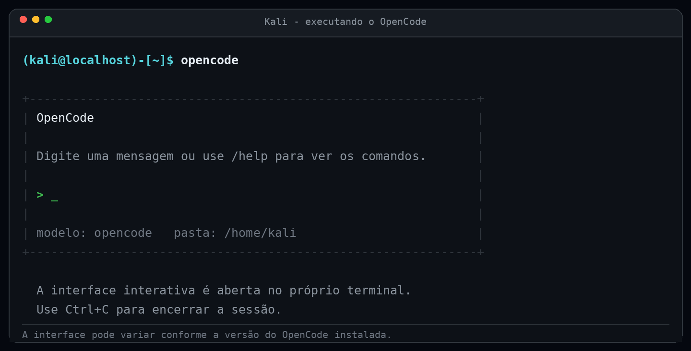

# Kali Linux + OpenCode CLI no Termux




Tutorial completo para instalar o **Kali Linux NetHunter Rootless** e o **OpenCode CLI** em um celular Android usando o **Termux**, sem precisar de root e sem remover o Android.

O guia cobre desde a preparação do Termux até a correção dos binários do NPM no ARM64, incluindo explicações de cada comando, uma instalação rápida em uma linha e uma seção de solução de problemas.

> Este é um material independente de estudo e referência. Não possui vínculo oficial com Termux, Offensive Security, Kali Linux ou OpenCode.

---

## Índice

1. [O que você vai instalar](#1-o-que-você-vai-instalar)
2. [Requisitos](#2-requisitos)
3. [Antes de começar](#3-antes-de-começar)
4. [Passo 1: preparar o Termux e baixar o Kali NetHunter](#4-passo-1-preparar-o-termux-e-baixar-o-kali-nethunter)
5. [Passo 2: instalar e acessar o Kali NetHunter](#5-passo-2-instalar-e-acessar-o-kali-nethunter)
6. [Passo 3: instalar Node.js e NPM](#6-passo-3-instalar-nodejs-e-npm)
7. [Passo 4: instalar o OpenCode CLI](#7-passo-4-instalar-o-opencode-cli)
8. [Passo 5: corrigir os binários no ARM64](#8-passo-5-corrigir-os-binários-no-arm64)
9. [Passo 6: executar e validar](#9-passo-6-executar-e-validar)
10. [Instalação rápida em uma linha](#10-instalação-rápida-em-uma-linha)
11. [Comandos úteis](#11-comandos-úteis)
12. [Solução de problemas](#12-solução-de-problemas)
13. [Atualização](#13-atualização)
14. [Perguntas frequentes](#14-perguntas-frequentes)
15. [Versões de referência](#15-versões-de-referência)
16. [Estrutura do repositório](#16-estrutura-do-repositório)
17. [Sobre as imagens](#17-sobre-as-imagens)
18. [Links oficiais](#18-links-oficiais)
19. [Licença](#19-licença)

---

## 1. O que você vai instalar

| Componente | Para que serve |
|---|---|
| **Termux** | Emulador de terminal Linux para Android. É o ambiente inicial onde o instalador será executado. |
| **Kali NetHunter Rootless** | Sistema Kali Linux completo executado dentro do Termux com o auxílio do proot. Não exige root nem desbloqueio de bootloader. |
| **Node.js** | Interpretador JavaScript necessário para executar o instalador e o próprio OpenCode, que é distribuído como pacote Node. |
| **NPM** | Gerenciador de pacotes do Node.js. Será usado para instalar o OpenCode globalmente. |
| **OpenCode CLI** | Ferramenta de linha de comando com interface de terminal para trabalhar com modelos de linguagem, arquivos e projetos. |

### Como as peças se encaixam



O Termux fornece um ambiente Linux básico no Android. O instalador do NetHunter baixa uma imagem do Kali Linux (rootfs) e cria um script chamado `nh`. Ao executar `nh`, o Kali é iniciado dentro do Termux por meio do **proot**, uma camada que traduz chamadas de sistema e permite rodar uma distribuição Linux sem privilégios de root.

Dentro do Kali, o APT instala o Node.js e o NPM. Em seguida, o NPM instala o OpenCode. Como o Android é ARM64, o pacote do OpenCode precisa copiar o binário correto para a pasta `bin` e receber permissão de execução.

---

## 2. Requisitos

- Celular Android com arquitetura **ARM64** (a maioria dos aparelhos atuais).
- **Termux** instalado pelo **F-Droid** ou pelas **GitHub Releases** do projeto.
- Entre **4 GB e 5 GB** de armazenamento interno livre.
- Conexão estável com a internet, preferencialmente Wi-Fi.
- Bateria acima de 50 por cento ou carregador conectado.
- Cerca de **20 a 40 minutos** para concluir o processo.

### Sobre a versão do Termux

Não use a versão disponibilizada na Google Play Store. Ela está desatualizada e pode apresentar falhas de compatibilidade com pacotes e repositórios atuais.

Instale preferencialmente por uma destas fontes:

- F-Droid: <https://f-droid.org/packages/com.termux/>
- GitHub Releases: <https://github.com/termux/termux-app/releases>

Se você já possui outra versão do Termux instalada, faça backup dos arquivos importantes antes de trocar de versão. Versões instaladas por fontes diferentes podem usar assinaturas distintas e exigir a remoção da versão antiga.

---

## 3. Antes de começar

1. Faça backup dos arquivos que estão no armazenamento compartilhado do celular.
2. Conecte o aparelho ao carregador ou garanta bateria suficiente.
3. Use uma conexão Wi-Fi estável, pois o download inicial do Kali é grande.
4. Desative a otimização de bateria para o Termux nas configurações do Android, se possível. Isso evita que o sistema encerre a instalação quando a tela apagar.
5. Mantenha o Termux em primeiro plano durante o download e a extração do Kali.
6. Leia cada etapa antes de executar os comandos.

> **Atenção:** o processo instala um sistema Linux completo dentro do Android. Ele não faz root, não altera a partição do sistema e não remove o Android. Ainda assim, use por sua conta e risco e mantenha backups.

---

## 4. Passo 1: preparar o Termux e baixar o Kali NetHunter

Abra o Termux e conceda permissão de armazenamento:

```bash
termux-setup-storage
```

O Android exibirá um pedido de permissão. Toque em **Permitir**. Esse comando cria atalhos para as pastas do armazenamento compartilhado dentro do Termux, como `~/storage/downloads`.

Atualize os repositórios locais e instale as ferramentas básicas:

```bash
pkg update -y && pkg install wget tar curl -y
```

O que cada parte faz:

- `pkg update -y`: atualiza a lista de pacotes disponíveis. A opção `-y` confirma automaticamente as perguntas.
- `pkg install wget tar curl -y`: instala o `wget` para baixar o instalador, o `tar` para extrair arquivos e o `curl` para transferências e testes de conexão.

Baixe o script oficial de instalação do Kali NetHunter Rootless:

```bash
wget -O install-nethunter-termux https://offs.ec/2MceZWr
```

- `-O install-nethunter-termux`: salva o conteúdo baixado com esse nome de arquivo.
- `https://offs.ec/2MceZWr`: atalho oficial usado pela documentação do Kali NetHunter.

Conceda permissão de execução e inicie o instalador:

```bash
chmod +x install-nethunter-termux
./install-nethunter-termux
```



Durante o processo, o instalador poderá fazer algumas perguntas. Uma das mais comuns é:

```text
Delete downloaded rootfs file? [y/N]
```

Digite `y` e pressione Enter para excluir o arquivo compactado temporário. Isso libera aproximadamente 1,5 GB de armazenamento. O sistema já extraído permanece instalado e funcional.



O download e a extração podem demorar bastante, dependendo da velocidade da internet e do armazenamento do aparelho. Não feche o Termux e não bloqueie a tela durante essa etapa.

> **Nota:** as perguntas e mensagens do instalador podem mudar conforme a versão do Kali NetHunter. Leia o texto apresentado e confirme apenas o que fizer sentido para o seu caso.

---

## 5. Passo 2: instalar e acessar o Kali NetHunter

Depois que o instalador terminar, inicie o Kali:

```bash
nh
```

Na primeira inicialização, o Kali pode levar alguns segundos ou minutos para preparar o ambiente. Quando estiver pronto, o prompt do terminal mudará para algo semelhante a:

```text
(kali@localhost)-[~]$
```



A senha padrão do usuário `kali` é:

```text
kali
```

Essa senha é solicitada quando você usa `sudo`, por exemplo. Ao digitá-la, os caracteres não aparecem na tela. Isso é normal e faz parte do funcionamento do terminal. Digite a senha e pressione Enter.

### Comandos de navegação

| Ação | Comando |
|---|---|
| Entrar no Kali Linux | `nh` |
| Entrar no Kali como superusuário (root) | `nh -r` |
| Sair do Kali e voltar ao Termux | `exit` |
| Ver o usuário atual | `whoami` |
| Ver o diretório atual | `pwd` |

> **Dica:** use `exit` para voltar ao Termux quando precisar executar comandos do Termux. Para entrar novamente no Kali, execute `nh`.

---

## 6. Passo 3: instalar Node.js e NPM

Dentro do Kali, atualize as listas de pacotes do Debian/Kali e instale o Node.js e o NPM:

```bash
sudo apt update && sudo apt install nodejs npm -y
```

O que cada parte faz:

- `sudo`: executa o comando com privilégios administrativos. Será pedida a senha do usuário `kali`.
- `apt update`: atualiza a lista de pacotes disponíveis nos repositórios.
- `apt install nodejs npm -y`: instala o interpretador Node.js e o gerenciador de pacotes NPM.
- `-y`: responde automaticamente "sim" às perguntas de instalação.



Verifique as versões instaladas:

```bash
node --version
npm --version
```

Um resultado esperado é algo como `v24.x.x` para o Node.js e `12.x.x` para o NPM. Os números podem variar conforme a atualização do Kali.

> **Nota:** o comando `apt update` atualiza apenas a lista de pacotes. Ele não atualiza o sistema. Para atualizar os pacotes já instalados, use `sudo apt full-upgrade -y` quando desejar.

---

## 7. Passo 4: instalar o OpenCode CLI

Com o Node.js e o NPM funcionando, instale o pacote do OpenCode globalmente:

```bash
npm install -g @opencode/cli
```

- `install`: baixa e instala o pacote.
- `-g`: instala globalmente, deixando o comando disponível para todos os diretórios.
- `@opencode/cli`: nome do pacote no registro do NPM.

Adicione o diretório global de binários do NPM à variável `PATH`:

```bash
echo 'export PATH="$(npm config get prefix)/bin:$PATH"' >> ~/.bashrc
source ~/.bashrc
```

Entenda o comando:

- `npm config get prefix`: mostra o diretório de instalação global do NPM, normalmente `/usr/local`.
- A pasta de executáveis fica em `$(npm config get prefix)/bin`, normalmente `/usr/local/bin`.
- `>> ~/.bashrc`: acrescenta a configuração ao final do arquivo de inicialização do Bash.
- `source ~/.bashrc`: recarrega o arquivo na sessão atual, sem precisar abrir outro terminal.



### Se aparecer erro de permissão (EACCES)

Em algumas instalações do Kali, a pasta global do NPM pertence ao usuário `root`. Nesse caso, o comando sem `sudo` retorna um erro parecido com este:

```text
npm ERR! code EACCES
npm ERR! syscall mkdir
npm ERR! path /usr/local/lib/node_modules/@opencode
npm ERR! errno -13
```

Existem duas soluções. Escolha apenas uma delas.

**Opção A: instalar com sudo (mais simples)**

```bash
sudo npm install -g @opencode/cli
```

Como o NPM executa o script `postinstall` automaticamente durante a instalação, o binário já será criado com as permissões corretas. Nesse caso, pule o Passo 5 e vá direto para o Passo 6.

**Opção B: usar uma pasta global do usuário, sem sudo**

```bash
npm config set prefix ~/.npm-global
echo 'export PATH="$HOME/.npm-global/bin:$PATH"' >> ~/.bashrc
source ~/.bashrc
npm install -g @opencode/cli
```

Nesse caso, o caminho retornado por `which opencode` será algo como `/home/kali/.npm-global/bin/opencode`.

> **Importante:** não use `sudo` apenas para contornar erros sem entender a causa. Entender onde o pacote foi instalado evita problemas com o `PATH` e com o script `postinstall` mais adiante.

---

## 8. Passo 5: corrigir os binários no ARM64

O pacote `@opencode/cli` funciona como um instalador: ele baixa ou copia o binário compilado para a arquitetura do aparelho. Em distribuições ARM64 no Android, pode ser necessário executar o script de pós-instalação e garantir permissão de execução.

Navegue até o diretório interno do pacote instalado:

```bash
cd $(npm root -g)/@opencode/cli
```

- `npm root -g`: mostra o diretório onde os pacotes globais são armazenados.
- `@opencode/cli`: pasta do pacote que acabamos de instalar.

Execute o script de compilação/instalação:

```bash
node ./postinstall.mjs
```

Conceda permissão de execução aos arquivos gerados na pasta `bin`:

```bash
chmod +x ./bin/*
```

Retorne à pasta raiz do usuário:

```bash
cd ~
```



O script `postinstall.mjs` detecta o sistema operacional e a arquitetura, procura o pacote opcional correspondente, como `@opencode/cli-linux-arm64`, copia o binário para `bin/opencode.exe` e aplica permissão de execução. O comando `chmod +x` reforça essa permissão caso o arquivo tenha sido gerado sem ela.

> **Nota:** o nome `opencode.exe` pode parecer estranho em Linux, mas é apenas o nome definido pelo pacote. O arquivo é um executável nativo para Linux ARM64, não um programa do Windows.

> **Se você instalou com `sudo`:** o `postinstall` já foi executado como root durante a instalação. Executar `node ./postinstall.mjs` como usuário comum pode falhar por falta de permissão de escrita. Nesse caso, pule esta etapa e siga para o Passo 6.

---

## 9. Passo 6: executar e validar

Verifique se o binário foi localizado corretamente no sistema:

```bash
which opencode
```

Um resultado esperado é:

```text
/usr/local/bin/opencode
```

Também é possível conferir a versão:

```bash
opencode --version
```

Inicie o OpenCode CLI:

```bash
opencode
```



A interface interativa será aberta no próprio terminal. Use `Ctrl+C` para encerrar a sessão quando necessário.

Para usar um modelo de linguagem, será necessário configurar um provedor e as credenciais correspondentes. O comando exato pode variar conforme a versão do OpenCode. Consulte a interface com `/help` ou a documentação oficial em <https://opencode.ai/docs>.

---

## 10. Instalação rápida em uma linha

Se você já estiver dentro do Kali NetHunter, o comando abaixo executa toda a instalação e o ajuste dos binários de uma vez:

```bash
sudo apt update && sudo apt install nodejs npm -y && npm install -g @opencode/cli && echo 'export PATH="$(npm config get prefix)/bin:$PATH"' >> ~/.bashrc && source ~/.bashrc && cd $(npm root -g)/@opencode/cli && node ./postinstall.mjs && chmod +x ./bin/* && cd ~ && opencode
```

> **Atenção:** execute esse comando **dentro do Kali**, não no Termux. Ele pressupõe que o usuário tem permissão de escrita no prefixo global do NPM. Se ocorrer `EACCES`, use a versão com `sudo` abaixo.

Versão alternativa com `sudo`, mais resistente a problemas de permissão:

```bash
sudo apt update && sudo apt install nodejs npm -y && sudo npm install -g @opencode/cli && opencode
```

Nessa versão com `sudo`, o script `postinstall` já é executado pelo NPM durante a instalação. Por isso, não é necessário rodar `node ./postinstall.mjs` nem `chmod +x` novamente.

---

## 11. Comandos úteis

| Ação | Comando |
|---|---|
| Entrar no Kali Linux | `nh` |
| Entrar no Kali como superusuário (root) | `nh -r` |
| Sair do Kali e voltar ao Termux | `exit` |
| Executar a CLI | `opencode` |
| Ver a versão do OpenCode | `opencode --version` |
| Localizar o executável do OpenCode | `which opencode` |
| Ver o prefixo global do NPM | `npm config get prefix` |
| Ver a pasta global de pacotes do NPM | `npm root -g` |
| Atualizar o Kali | `sudo apt update && sudo apt full-upgrade -y` |
| Ver o espaço livre em disco | `df -h` |

---

## 12. Solução de problemas

### 12.1 O comando `termux-setup-storage` não mostra o pedido de permissão

Verifique manualmente nas configurações do Android:

1. Abra **Configurações**.
2. Acesse **Aplicativos** e localize **Termux**.
3. Abra **Permissões**.
4. Conceda a permissão de **Armazenamento**.

Depois execute novamente:

```bash
termux-setup-storage
```

### 12.2 Erro `wget: command not found`

Instale o `wget` novamente:

```bash
pkg install wget -y
```

Se o erro persistir, atualize os repositórios do Termux:

```bash
pkg update -y
pkg install wget tar curl -y
```

### 12.3 Erro `Permission denied` ao executar o instalador

O arquivo baixado pode não ter permissão de execução. Corrija com:

```bash
chmod +x install-nethunter-termux
./install-nethunter-termux
```

### 12.4 O comando `nh` não é encontrado

Feche e abra o Termux novamente. Em seguida, recarregue o arquivo de inicialização:

```bash
source ~/.bashrc
```

Se o erro continuar, confirme que o instalador do NetHunter terminou sem erros. O comando `nh` é criado pelo instalador na pasta de binários do Termux.

### 12.5 Esqueci a senha do usuário kali

A senha padrão é `kali`. Se ela foi alterada e você não se lembra, entre no Kali como root:

```bash
nh -r
```

Depois redefina a senha do usuário `kali`:

```bash
passwd kali
```

### 12.6 Erro `npm: command not found`

Instale o Node.js e o NPM novamente:

```bash
sudo apt update
sudo apt install nodejs npm -y
```

Depois recarregue o ambiente:

```bash
hash -r
node --version
npm --version
```

### 12.7 Erro `EACCES` ao instalar o OpenCode

Use uma das soluções da seção [Passo 4](#7-passo-4-instalar-o-opencode-cli):

```bash
sudo npm install -g @opencode/cli
```

Ou configure um prefixo de usuário:

```bash
npm config set prefix ~/.npm-global
echo 'export PATH="$HOME/.npm-global/bin:$PATH"' >> ~/.bashrc
source ~/.bashrc
npm install -g @opencode/cli
```

### 12.8 Erro no postinstall: `OpenCode does not provide a binary for linux-arm64`

Confirme a arquitetura do ambiente:

```bash
uname -m
node -p "process.arch"
```

O `uname -m` deve mostrar `aarch64`, e `node -p "process.arch"` deve mostrar `arm64`. Se estiver correto, reinstale o pacote incluindo as dependências opcionais:

```bash
sudo npm uninstall -g @opencode/cli
sudo npm install -g @opencode/cli --include=optional
```

Se ainda falhar, verifique se o pacote opcional foi baixado:

```bash
ls $(npm root -g)/@opencode/ | grep arm64
```

O resultado deve incluir algo como `cli-linux-arm64`.

### 12.9 `which opencode` não retorna nada

Confira onde o NPM instalou o pacote e o binário:

```bash
npm config get prefix
npm root -g
ls -l $(npm config get prefix)/bin/opencode
```

Se o arquivo existir mas o comando não for encontrado, adicione a pasta ao `PATH`:

```bash
echo 'export PATH="$(npm config get prefix)/bin:$PATH"' >> ~/.bashrc
source ~/.bashrc
```

Como alternativa, crie um link simbólico:

```bash
sudo ln -sf $(npm root -g)/@opencode/cli/bin/opencode.exe /usr/local/bin/opencode
```

### 12.10 Erro de GLIBC ao executar o OpenCode

Se aparecer uma mensagem parecida com `GLIBC_2.xx not found`, o binário foi compilado para uma versão mais nova da biblioteca C do que a disponível no seu Kali. Atualize o sistema:

```bash
sudo apt update
sudo apt full-upgrade -y
```

Depois tente novamente:

```bash
opencode --version
```

### 12.11 O processo é encerrado durante a instalação

O Android pode encerrar aplicativos em segundo plano para economizar bateria. Para evitar:

- mantenha o Termux aberto em primeiro plano;
- desative a otimização de bateria para o Termux;
- conecte o carregador;
- execute `termux-wake-lock` antes de iniciar uma instalação longa;
- para liberar o wake lock depois, use `termux-wake-unlock`.

### 12.12 Falta de espaço em disco

Verifique o espaço disponível:

```bash
df -h
```

Limpe o cache do APT e do NPM:

```bash
sudo apt clean
npm cache clean --force
```

Remova arquivos temporários que não sejam mais necessários. O Kali extraído e o OpenCode ocupam espaço permanente, então não apague pastas do sistema sem saber o que está fazendo.

### 12.13 O OpenCode abre, mas não responde a comandos de modelo

O OpenCode precisa de um provedor de modelos configurado. Verifique a documentação oficial e a interface:

- dentro do OpenCode, use `/help`;
- consulte <https://opencode.ai/docs>;
- confirme se as credenciais do provedor foram configuradas corretamente.

---

## 13. Atualização

Atualize o Kali e os pacotes do sistema:

```bash
sudo apt update
sudo apt full-upgrade -y
```

Atualize o OpenCode CLI:

```bash
sudo npm install -g @opencode/cli@latest
```

Confirme a versão:

```bash
opencode --version
```

> Se você instalou o OpenCode em um prefixo de usuário, remova o `sudo` do comando de atualização.

---

## 14. Perguntas frequentes

### Preciso de root no Android?

Não. O Kali NetHunter Rootless usa proot e roda como um aplicativo comum. O root do Android não é necessário para este tutorial.

### Preciso desbloquear o bootloader?

Não. O procedimento não altera a partição de boot nem instala uma recovery personalizada.

### Funciona em qualquer celular Android?

O tutorial é voltado para aparelhos **ARM64**. Aparelhos muito antigos, com pouca memória ou arquitetura diferente, podem não conseguir executar o Kali ou o OpenCode.

### Posso instalar o OpenCode direto no Termux, sem o Kali?

Sim, é possível instalar Node.js e o OpenCode diretamente no Termux. Este guia usa o Kali NetHunter porque o tutorial de referência foi construído dessa forma e porque o Kali já fornece um ambiente Debian completo com APT.

### Quanto espaço o processo ocupa?

Reserve no mínimo 4 GB a 5 GB. O Kali extraído, o OpenCode e os caches ocupam vários gigabytes durante e após a instalação. Se possível, tenha 8 GB ou mais de espaço livre para trabalhar com folga.

### Por que o binário se chama `opencode.exe`?

Esse é o nome definido pelo próprio pacote para o executável. Em Linux, a extensão `.exe` não indica um programa do Windows. O conteúdo é um binário nativo para Linux ARM64.

### O OpenCode é gratuito?

O CLI é um projeto de código aberto. O uso de modelos de linguagem depende do provedor escolhido, que pode exigir uma conta, uma chave de API ou um plano pago. Consulte a documentação oficial para saber os custos.

### Preciso de internet para usar o OpenCode?

A instalação exige internet. Depois de instalado, o funcionamento depende do modelo escolhido. Modelos executados localmente podem funcionar sem conexão, mas exigem hardware e configuração adicionais. Modelos remotos precisam de internet.

### Posso copiar comandos com `sudo` de qualquer site?

Não. Leia e entenda cada comando antes de executá-lo. Este repositório explica o que cada etapa faz justamente para que você possa revisar o processo.

---

## 15. Versões de referência

As imagens e os exemplos deste guia foram elaborados com base nas versões abaixo. Versões mais novas podem apresentar mensagens diferentes, mas o fluxo geral continua o mesmo.

| Componente | Versão de referência |
|---|---|
| Kali Linux | Kali Rolling (rootfs ARM64) |
| Node.js | 24.x |
| NPM | 12.x |
| OpenCode CLI | 2.1.4 |
| Termux | versão atual do F-Droid ou GitHub Releases |

---

## 16. Estrutura do repositório

```text
KALI-OPENCODE-TERMUX/
├── README.md
├── LICENSE
├── images/
│   ├── banner.png
│   ├── fluxo-instalacao.png
│   ├── passo-01-termux.png
│   ├── passo-02-instalador.png
│   ├── passo-03-kali.png
│   ├── passo-04-node-npm.png
│   ├── passo-05-opencode-install.png
│   ├── passo-06-binarios.png
│   └── passo-07-opencode.png
└── scripts/
    └── instalar-opencode.sh
```

O script `scripts/instalar-opencode.sh` automatiza a instalação dentro do Kali. Ele é opcional e deve ser lido antes da execução.

Para usar o script:

```bash
chmod +x scripts/instalar-opencode.sh
./scripts/instalar-opencode.sh
```

---

## 17. Sobre as imagens

As capturas de tela deste repositório são **recriações ilustrativas** do terminal, criadas para este guia. Elas não são fotografias de um aparelho real.

Os textos representam o comportamento esperado de cada etapa, mas a saída real pode variar conforme:

- a versão do Termux;
- a versão do Kali NetHunter;
- a versão do Node.js, do NPM e do OpenCode;
- a velocidade da conexão e o modelo do aparelho.

Se você quiser substituir as imagens por capturas reais do seu aparelho, mantenha os mesmos nomes de arquivo para que o README continue funcionando.

---

## 18. Links oficiais

- Termux: <https://termux.dev>
- Termux no F-Droid: <https://f-droid.org/packages/com.termux/>
- Termux no GitHub: <https://github.com/termux/termux-app>
- Kali Linux: <https://www.kali.org>
- Kali NetHunter: <https://www.kali.org/get-kali/#kali-mobile>
- Documentação do Kali NetHunter: <https://www.kali.org/docs/nethunter/>
- OpenCode: <https://opencode.ai>
- Documentação do OpenCode: <https://opencode.ai/docs>
- Repositório do OpenCode: <https://github.com/anomalyco/opencode>
- Pacote no NPM: <https://www.npmjs.com/package/@opencode/cli>
- Node.js: <https://nodejs.org>
- NPM: <https://www.npmjs.com>

---

## 19. Licença

Este projeto está licenciado sob a licença MIT. Consulte o arquivo [LICENSE](LICENSE) para mais informações.

---

Se este guia ajudou você, considere deixar uma estrela no repositório e compartilhar as correções que funcionaram no seu aparelho. Contribuições são bem-vindas.
